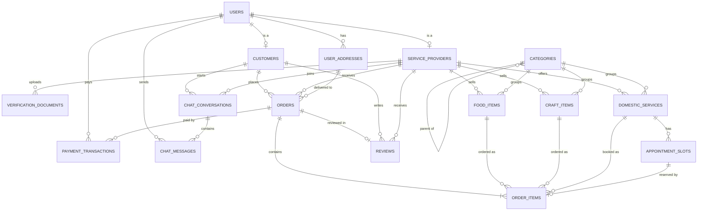
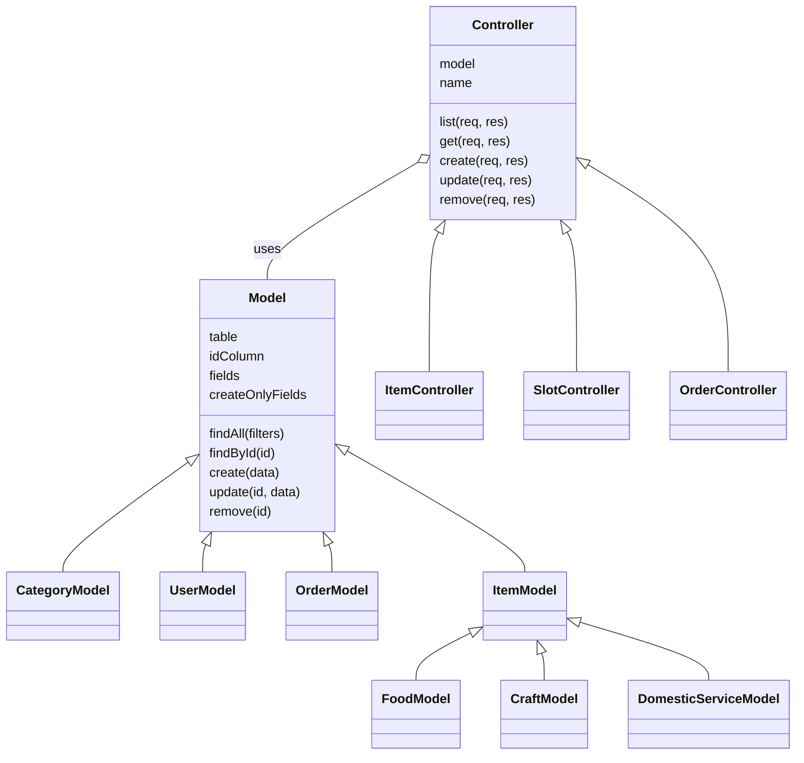

# CHAPTER 2 — SYSTEM DESIGN

Recently, online marketplaces have become among the most widely used systems in our daily life, due to the spread of smartphones, the growth of e-commerce and online payment, and the need for flexible work opportunities. The Women Empowerment Multi-Service Platform applies this idea to home-based women providers: it connects them with customers who want homemade food, handmade products and household services, and gives them a safe, verified channel to sell from home.

The main parts of the platform are as follows:

- Backend Database Server (MySQL / MariaDB, served by XAMPP)
- Backend Web Server (Node.js + Express.js)
- Backend APIs (RESTful JSON APIs secured with JWT)
- Frontend web application (consumes the APIs)
- Testing tools (Postman collection + automated Node.js test)

This chapter begins with the Database Design (section 2.1), illustrates the web server design using Node.js (section 2.2), and finally explains API design and testing (section 2.3).

---

## 2.1 DATABASE DESIGN

The database `women_platform` runs on MySQL (MariaDB) inside XAMPP and is managed through phpMyAdmin. It contains **16 tables**, all using the InnoDB engine (needed for foreign keys and transactions) and the `utf8mb4` character set (supports Arabic text and emoji).

### 2.1.1 ER Diagram

> Paste the code below into https://mermaid.live and export it as PNG for the report, or use phpMyAdmin → `women_platform` → **More → Designer** for a screenshot of the real tables.



### 2.1.2 Table Attributes

PK = Primary Key, FK = Foreign Key, UQ = Unique.

**1. users** — every account (customer, provider or admin)

| Attribute | Type | Constraints |
|---|---|---|
| user_id | INT | PK, AUTO_INCREMENT |
| full_name | VARCHAR(100) | NOT NULL, not empty |
| email | VARCHAR(255) | NOT NULL, UQ, valid email format |
| password | VARCHAR(255) | NOT NULL (bcrypt hash) |
| phone_number | VARCHAR(30) | |
| user_type | ENUM('customer','provider','admin') | NOT NULL |
| created_at | DATETIME | DEFAULT CURRENT_TIMESTAMP |

**2. customers**

| Attribute | Type | Constraints |
|---|---|---|
| customer_id | INT | PK |
| user_id | INT | FK → users, UQ |
| loyalty_points | INT | DEFAULT 0, ≥ 0 |

**3. service_providers**

| Attribute | Type | Constraints |
|---|---|---|
| provider_id | INT | PK |
| user_id | INT | FK → users, UQ |
| store_name | VARCHAR(150) | NOT NULL |
| national_id | VARCHAR(30) | UQ |
| rating | DECIMAL(2,1) | DEFAULT 0 (average of reviews) |
| verification_status | ENUM('pending','accepted','rejected') | DEFAULT 'pending' |

**4. verification_documents**

| Attribute | Type | Constraints |
|---|---|---|
| document_id | INT | PK |
| provider_id | INT | FK → service_providers |
| document_type | ENUM('id_card','criminal_record','birth_certificate') | NOT NULL |
| file_url | VARCHAR(500) | NOT NULL |
| uploaded_at | DATETIME | DEFAULT CURRENT_TIMESTAMP |

**5. user_addresses**

| Attribute | Type | Constraints |
|---|---|---|
| address_id | INT | PK |
| user_id | INT | FK → users |
| street_address | VARCHAR(255) | NOT NULL |
| city | VARCHAR(100) | NOT NULL |
| district, building_number, floor | VARCHAR | optional |

**6. categories**

| Attribute | Type | Constraints |
|---|---|---|
| category_id | INT | PK |
| category_name | VARCHAR(100) | NOT NULL, UQ |
| description | TEXT | |
| parent_category_id | INT | FK → categories (self-reference) |

**7. food_items**

| Attribute | Type | Constraints |
|---|---|---|
| food_item_id | INT | PK |
| provider_id | INT | FK → service_providers |
| category_id | INT | FK → categories |
| title | VARCHAR(150) | NOT NULL |
| description | TEXT | |
| price | DECIMAL(10,2) | NOT NULL, ≥ 0 |
| stock_quantity | INT | ≥ 0 (NULL = made to order) |
| is_available | BOOLEAN | DEFAULT TRUE |
| preparation_time_min | INT | > 0 |
| nutrition_facts | TEXT | |
| created_at | DATETIME | DEFAULT CURRENT_TIMESTAMP |

**8. craft_items**

| Attribute | Type | Constraints |
|---|---|---|
| craft_item_id | INT | PK |
| provider_id / category_id | INT | FK |
| title | VARCHAR(150) | NOT NULL |
| description | TEXT | |
| price | DECIMAL(10,2) | NOT NULL, ≥ 0 |
| stock_quantity | INT | ≥ 0 |
| customizable | BOOLEAN | DEFAULT FALSE |
| material_used | VARCHAR(150) | |
| created_at | DATETIME | |

**9. domestic_services**

| Attribute | Type | Constraints |
|---|---|---|
| service_id | INT | PK |
| provider_id / category_id | INT | FK |
| title | VARCHAR(150) | NOT NULL |
| description | TEXT | |
| hourly_rate | DECIMAL(10,2) | NOT NULL, ≥ 0 |
| hours_needed | DECIMAL(4,1) | DEFAULT 1, > 0 |
| created_at | DATETIME | |

**10. appointment_slots**

| Attribute | Type | Constraints |
|---|---|---|
| slot_id | INT | PK |
| service_id | INT | FK → domestic_services |
| slot_date | DATE | NOT NULL |
| start_time / end_time | TIME | NOT NULL, end_time > start_time |
| is_booked | BOOLEAN | DEFAULT FALSE |

**11. orders**

| Attribute | Type | Constraints |
|---|---|---|
| order_id | INT | PK |
| customer_id | INT | FK → customers |
| provider_id | INT | FK → service_providers |
| delivery_address_id | INT | FK → user_addresses |
| special_instruction | TEXT | |
| status | ENUM('pending','accepted','in_progress','completed','cancelled') | DEFAULT 'pending' |
| sub_total_amount, delivery_fee, total_amount | DECIMAL(10,2) | NOT NULL |
| order_date | DATETIME | DEFAULT CURRENT_TIMESTAMP |

**12. order_items**

| Attribute | Type | Constraints |
|---|---|---|
| order_item_id | INT | PK |
| order_id | INT | FK → orders |
| item_type | ENUM('food','craft','service') | NOT NULL |
| food_item_id / craft_item_id / service_id | INT | FK (one used, matching item_type) |
| slot_id | INT | FK → appointment_slots |
| unit_price | DECIMAL(10,2) | NOT NULL |
| quantity | INT | DEFAULT 1, ≥ 1 |
| sub_total | DECIMAL(10,2) | NOT NULL |

**13. payment_transactions**

| Attribute | Type | Constraints |
|---|---|---|
| transaction_id | INT | PK |
| order_id | INT | FK → orders |
| user_id | INT | FK → users |
| amount | DECIMAL(10,2) | ≥ 0 |
| payment_method | ENUM('cash','card') | NOT NULL |
| payment_status | ENUM('pending','success','failed') | DEFAULT 'pending' |
| created_at | DATETIME | |

**14. reviews**

| Attribute | Type | Constraints |
|---|---|---|
| review_id | INT | PK |
| order_id | INT | FK → orders, UQ (one review per order) |
| customer_id / provider_id | INT | FK |
| rating | INT | 1 – 5 |
| comment | TEXT | |
| created_at | DATETIME | |

**15. chat_conversations**

| Attribute | Type | Constraints |
|---|---|---|
| conversation_id | INT | PK |
| customer_id / provider_id | INT | FK, UQ together |
| created_at, last_message_at | DATETIME | |

**16. chat_messages**

| Attribute | Type | Constraints |
|---|---|---|
| message_id | INT | PK |
| conversation_id | INT | FK → chat_conversations |
| sender_id | INT | FK → users |
| message_text | TEXT | NOT NULL |
| is_read | BOOLEAN | DEFAULT FALSE |
| sent_at | DATETIME | |

### 2.1.3 Relationships

| Relationship | Type | Description |
|---|---|---|
| users – customers | 1 : 1 | A customer account extends one user (specialisation) |
| users – service_providers | 1 : 1 | A provider account extends one user |
| users – user_addresses | 1 : N | A user can save many addresses |
| service_providers – verification_documents | 1 : N | A provider uploads ID card, criminal record, etc. |
| service_providers – food_items / craft_items / domestic_services | 1 : N | A provider sells many products and services |
| categories – categories | 1 : N (recursive) | A category can have sub-categories |
| categories – items | 1 : N | Each item belongs to one category |
| domestic_services – appointment_slots | 1 : N | A service has many bookable time slots |
| customers – orders | 1 : N | A customer places many orders |
| service_providers – orders | 1 : N | Each order goes to one provider |
| orders – order_items | 1 : N | An order contains one or more lines |
| order_items – food/craft/service | N : 1 | Each line refers to exactly one item |
| appointment_slots – order_items | 1 : 1 | A booked slot is reserved by one order line |
| orders – payment_transactions | 1 : N | An order can have several payment attempts |
| orders – reviews | 1 : 1 | One review per completed order |
| customers – chat_conversations – service_providers | M : N | Resolved by chat_conversations (one per customer–provider pair) |
| chat_conversations – chat_messages | 1 : N | A conversation holds many messages |

**Referential actions:** deleting a user cascades to their profile, addresses, items and orders (`ON DELETE CASCADE`); deleting a category or an item sets the reference to `NULL` (`ON DELETE SET NULL`) so order history and prices are kept.

---

## 2.2 WEB SERVER DESIGN

### 2.2.1 Technologies

| Component | Technology | Role |
|---|---|---|
| Local server package | **XAMPP** | Runs **MySQL/MariaDB** (port 3306) and **Apache** for **phpMyAdmin** |
| Runtime | **Node.js** | Runs the JavaScript backend |
| Web framework | **Express.js 5** | Routing, middleware, JSON handling |
| DB driver | **mysql2** | Connection pool + parameterised queries (prevents SQL injection) |
| Security | **bcryptjs**, **jsonwebtoken** | Password hashing and JWT login tokens |

### 2.2.2 Setting up XAMPP

1. Open the XAMPP Control Panel and start **Apache** and **MySQL**.
2. Open `http://localhost/phpmyadmin` → **Import** → choose `database/women_platform.sql` → **Import**. This creates the `women_platform` database with its 16 tables and demo data.
3. Copy `.env.example` to `.env`:

```env
PORT=3000
DATABASE_URL=mysql://root:@localhost:3306/women_platform
JWT_SECRET=change-me-to-a-long-random-string
ADMIN_SECRET=dev-admin-secret
```

4. `npm install`, then `npm run dev` (auto-reload) or `npm start`.

> Screenshots to include: XAMPP Control Panel with Apache/MySQL green, phpMyAdmin showing the 16 tables, and the terminal showing `API running on http://localhost:3000`.

### 2.2.3 Folder Structure

The project follows a **modular (feature-based) MVC structure**: every feature has its own folder containing its **routes** (URLs), **controller** (request handling) and **model** (SQL).

```
women/
├── index.js                  # entry point: creates tables, starts the server
├── package.json
├── .env                      # configuration (port, DB URL, secrets)
├── postman_collection.json   # API tests
├── database/
│   └── women_platform.sql    # phpMyAdmin import file
├── src/
│   ├── app.js                # Express app, mounts all routes
│   ├── db/
│   │   ├── connection.js     # MySQL pool, query helpers, transactions
│   │   ├── schema.sql        # 16 tables
│   │   └── seed.sql, seed.js # demo data
│   ├── middleware/
│   │   ├── auth.middleware.js       # JWT, roles, verified provider
│   │   ├── error.middleware.js      # errors → JSON + status code
│   │   └── not-found.middleware.js  # 404
│   ├── core/
│   │   ├── Model.js          # parent class: CRUD SQL for any table
│   │   └── Controller.js     # parent class: CRUD request handlers
│   └── modules/
│       ├── auth/  user/  address/  category/  provider/  document/
│       ├── item/  slot/  order/  payment/  review/  chat/
│       │   └── *.routes.js, *.controller.js, *.model.js
└── test/
    └── api.test.js           # end-to-end test
```

### 2.2.4 Listening Port

The server listens on port **3000** (configurable through `PORT` in `.env`). MySQL listens on port **3306** and phpMyAdmin is served by Apache on port **80**. Base URL of the API: `http://localhost:3000/api`.

**index.js**

```js
const app = require('./src/app');
const { init } = require('./src/db/connection');

const { PORT = 3000 } = process.env;
if (!process.env.JWT_SECRET || !process.env.DATABASE_URL) {
  throw new Error('JWT_SECRET and DATABASE_URL must be set (copy .env.example to .env)');
}

init().then(() => {
  app.listen(PORT, () => console.log(`API running on http://localhost:${PORT}`));
});
```

### 2.2.5 Code Snippets

**Express application and route mounting — `src/app.js`**

```js
const app = express();
app.use(express.json());

app.get('/api/health', (req, res) => res.json({ status: 'ok' }));
app.use('/api/auth', require('./modules/auth/auth.routes'));
app.use('/api/users', require('./modules/user/user.routes'));
app.use('/api/categories', require('./modules/category/category.routes'));
app.use('/api/providers', require('./modules/provider/provider.routes'));
app.use('/api/foods', itemRoutes(require('./modules/item/food.model'), 'Food item'));
app.use('/api/crafts', itemRoutes(require('./modules/item/craft.model'), 'Craft item'));
app.use('/api/services', itemRoutes(require('./modules/item/service.model'), 'Service'));
app.use('/api/orders', require('./modules/order/order.routes'));
// ... addresses, documents, slots, payments, reviews, conversations

app.use(notFound);
app.use(errorHandler);
```

**Database connection to XAMPP MySQL — `src/db/connection.js`**

```js
const pool = mysql.createPool({
  uri: process.env.DATABASE_URL,   // mysql://root:@localhost:3306/women_platform
  decimalNumbers: true,
  dateStrings: true,
});

// Runs fn(connection) inside a transaction; any error rolls everything back.
async function transaction(fn) {
  const conn = await pool.getConnection();
  try {
    await conn.beginTransaction();
    const result = await fn(conn);
    await conn.commit();
    return result;
  } catch (err) {
    await conn.rollback();
    throw err;
  } finally {
    conn.release();
  }
}
```

**Authentication & authorisation middleware — `src/middleware/auth.middleware.js`**

```js
function auth(req, res, next) {
  const token = req.headers.authorization?.replace('Bearer ', '');
  if (!token) return res.status(401).json({ message: 'Login required' });
  try {
    req.user = jwt.verify(token, process.env.JWT_SECRET);
    next();
  } catch {
    res.status(401).json({ message: 'Invalid or expired token' });
  }
}

const role = (...types) => (req, res, next) =>
  types.includes(req.user.user_type) ? next()
    : res.status(403).json({ message: `Only ${types.join(' or ')} accounts can do this` });
```

**Example routes — `src/modules/item/item.routes.js`**

```js
router.get('/', controller.list);                                             // public search
router.get('/:id', controller.get);
router.post('/', auth, role('provider'), verifiedProvider, controller.create); // verified providers only
router.patch('/:id', auth, role('provider'), controller.loadOwn, controller.update);
router.delete('/:id', auth, role('provider'), controller.loadOwn, controller.remove);
```

**Login controller — `src/modules/auth/auth.controller.js`**

```js
class AuthController extends Controller {
  async login(req, res) {
    const { email, password } = req.body;
    const user = await this.model.findByEmailWithPassword(email);
    if (!user || !(await bcrypt.compare(String(password), user.password))) {
      return res.status(401).json({ message: 'Wrong email or password' });
    }
    const profile = await this.model.findProfile(user.user_id);
    res.json({ token: this.sign(profile), user: profile });
  }
}
```

**Central error handling — `src/middleware/error.middleware.js`**: converts database errors into clear HTTP responses (duplicate → `409`, invalid data / broken CHECK or FK → `400`, anything else → `500`).

### 2.2.6 Object-Oriented Design

Models and controllers are **classes**. Two parent classes in `src/core` hold the code every table needs, so each feature only writes what is special about it.



**A simple table needs only a few lines.** Categories get the full CRUD (list, get, create, update, delete) from the parent classes:

```js
// category.model.js
class CategoryModel extends Model {
  constructor() {
    super('categories', 'category_id', ['category_name', 'description', 'parent_category_id']);
  }
}
module.exports = new CategoryModel();

// category.controller.js
module.exports = new Controller(Category, 'Category');
```

| OOP principle | Where it is used |
|---|---|
| **Class & object** | Every model and controller is a class; each file exports one object (`new CategoryModel()`). |
| **Inheritance** | `CategoryModel extends Model`; `FoodModel extends ItemModel extends Model` (three levels); `SlotController extends Controller`. |
| **Encapsulation** | Each model keeps its table name, columns and SQL inside the class. Only the listed `fields` can be written, so extra data in a request is ignored. `UserModel` hides the password column from every query. |
| **Polymorphism (overriding)** | `DomesticServiceModel.unitPrice()` returns `hourly_rate × hours_needed`, while food and crafts use `price`. `OrderModel` calls `unitPrice()` without knowing which kind of item it has. `UserModel.create()` and `MessageModel.create()` override `Model.create()` and call `super.create()`. |
| **Abstraction** | Controllers call `this.model.findById(id)` and never write SQL themselves. |

### 2.2.7 Request Flow

```
Client (Frontend / Postman)
   │  HTTP + JSON  (Authorization: Bearer <JWT>)
   ▼
Express (app.js) → Router (*.routes.js) → Middleware (auth, role, verifiedProvider)
   → Controller (*.controller.js) → Model (*.model.js, SQL) → MySQL (XAMPP)
   ◄────────────────────── JSON response + status code ─────────────────────
```

---

## 2.3 API DESIGN

### 2.3.1 Design Principles

- **RESTful**: resources are nouns (`/foods`, `/orders`), actions are HTTP methods (GET, POST, PATCH, DELETE).
- **JSON** request and response bodies.
- **JWT authentication**: `/auth/login` and `/auth/register` return a token, sent afterwards in the header `Authorization: Bearer <token>` (valid 7 days).
- **Role-based access**: `customer`, `provider`, `admin`; providers must be **verified by an admin** before selling.
- **Standard status codes**: `200` OK, `201` Created, `204` Deleted, `400` invalid data, `401` not logged in, `403` not allowed, `404` not found, `409` duplicate.

### 2.3.2 Endpoints

Base URL: `http://localhost:3000/api`

| Module | Method | Endpoint | Access | Description |
|---|---|---|---|---|
| Health | GET | /health | Public | Server status |
| Auth | POST | /auth/register | Public | Register customer / provider / admin |
| | POST | /auth/login | Public | Login, returns JWT |
| | GET | /auth/me | Logged in | Current user profile |
| Users | GET | /users | Admin | List users (filters, e.g. pending providers) |
| | PATCH | /users/me | Logged in | Update my profile |
| | DELETE | /users/me | Logged in | Delete my account |
| Addresses | GET / POST | /addresses | Logged in | My addresses / add address |
| | GET / PATCH / DELETE | /addresses/:id | Owner | Read / update / delete |
| Categories | GET | /categories, /categories/:id | Public | List / get |
| | POST / PATCH / DELETE | /categories(/:id) | Admin | Manage categories |
| Providers | GET | /providers, /providers/:id | Public | List / profile |
| | PATCH | /providers/me | Provider | Update my store |
| | PATCH | /providers/:id/verification | Admin | Accept / reject provider |
| Documents | GET | /documents | Provider, Admin | Verification documents |
| | POST / DELETE | /documents(/:id) | Provider | Upload / delete document |
| Food / Crafts / Services | GET | /foods, /crafts, /services | Public | Search (`q`, `max_price`, `provider_id`, `sort`) |
| | GET | /foods/:id … | Public | Item details |
| | POST | /foods … | Verified provider | Add item |
| | PATCH / DELETE | /foods/:id … | Owner provider | Update / delete item |
| Slots | GET | /slots | Public | Slots of a service (`service_id`, `is_booked`) |
| | POST / PATCH / DELETE | /slots(/:id) | Owner provider | Manage slots |
| Orders | POST | /orders | Customer | Place order (food, crafts, services + slot) |
| | GET | /orders, /orders/:id | Logged in | My orders / order with items |
| | PATCH | /orders/:id/status | Customer, Provider | accept → in_progress → completed / cancel |
| Payments | GET | /payments | Logged in | Payments (`order_id`) |
| | POST | /payments | Customer | Pay (cash / card) |
| | PATCH | /payments/:id/status | Provider | Confirm payment |
| Reviews | GET | /reviews | Public | Reviews (`provider_id`) |
| | POST | /reviews | Customer | Review a completed order |
| | PATCH / DELETE | /reviews/:id | Owner customer | Update / delete review |
| Chat | GET | /conversations | Customer, Provider | My conversations |
| | POST | /conversations | Customer | Start conversation with provider |
| | GET / POST | /conversations/:id/messages | Participants | Read / send messages |

### 2.3.3 Example Request and Response

**POST** `/api/auth/register`

```json
{
  "full_name": "Mona Ali",
  "email": "mona@example.com",
  "password": "secret123",
  "phone_number": "01000000000",
  "user_type": "provider",
  "store_name": "Mona's Kitchen"
}
```

Response **201 Created**

```json
{
  "token": "eyJhbGciOiJIUzI1NiIsInR5cCI6IkpXVCJ9...",
  "user": { "user_id": 2, "full_name": "Mona Ali", "user_type": "provider", "provider_id": 1, "...": "..." }
}
```

**POST** `/api/orders` (customer token)

```json
{
  "delivery_address_id": 1,
  "special_instruction": "Please ring twice",
  "items": [
    { "item_type": "food", "item_id": 1, "quantity": 2 },
    { "item_type": "service", "item_id": 1, "slot_id": 1 }
  ]
}
```

Response **201 Created** — the order with its calculated `sub_total_amount`, `total_amount` and `status: "pending"`. Booking the same slot again returns **400**.

### 2.3.4 Postman Testing

The file `postman_collection.json` contains **63 requests in 11 folders** that test the full business flow. Each request has a test script that checks the status code and automatically saves tokens and ids (e.g. `customerToken`, `foodId`, `orderId`) into collection variables, so the whole collection runs end-to-end with the **Collection Runner**.

**How to run:** Postman → Import → `postman_collection.json` → Run collection (folders in order). The variable `baseUrl` = `http://localhost:3000/api` and `adminSecret` must equal `ADMIN_SECRET`.

**Test cases and expected results**

| # | Folder | Test case | Expected |
|---|---|---|---|
| 1 | Auth | Register admin / provider / customer | 201 |
| 2 | Auth | Login | 200 + token |
| 3 | Auth | Login with wrong password | 401 |
| 4 | Auth | Get my profile / update profile | 200 |
| 5 | Categories | List categories | 200 |
| 6 | Categories | Create / update category (admin) | 201 / 200 |
| 7 | Categories | Create category as customer | 403 |
| 8 | Verification | Provider sells before verification | 403 |
| 9 | Verification | Upload document, list documents | 201 / 200 |
| 10 | Verification | Admin lists pending providers and accepts | 200 |
| 11 | Items | Create food, craft item, domestic service | 201 |
| 12 | Items | Create food with negative price | 400 |
| 13 | Items | Search foods (`q=chocolate&max_price=200&sort=price`) | 200 |
| 14 | Items | Update item as owner / as customer | 200 / 403 |
| 15 | Slots | Create slot, list free slots, update slot | 201 / 200 |
| 16 | Addresses | Add, list, update address | 201 / 200 |
| 17 | Orders | Place order (food + service) | 201 |
| 18 | Orders | Book the same slot again | 400 |
| 19 | Orders | Customer tries to accept order | 400 |
| 20 | Orders | Provider accepts → in_progress → completed | 200 |
| 21 | Payments | Pay cash, provider confirms, list payments | 201 / 200 |
| 22 | Reviews | Add review | 201 |
| 23 | Reviews | Second review for the same order | 409 |
| 24 | Reviews | Update review, list provider reviews | 200 |
| 25 | Chat | Start conversation, send, read, reply | 201 / 200 |
| 26 | Cleanup | Delete review, address, item, document, category, accounts | 204 |

> **Screenshots to include** (readable size): the Collection Runner summary showing all tests passed; one success request (e.g. *Login* with the token in the response); one protected request showing the `Authorization: Bearer {{token}}` header; and one error case (e.g. *Login (wrong password) → 401* or *Second review → 409*).

**Automated test:** in addition to Postman, `npm test` runs `test/api.test.js`, an end-to-end test with Node's built-in test runner. It creates a temporary database `women_platform_test`, runs the full flow and deletes the database at the end, so real data is never affected.
